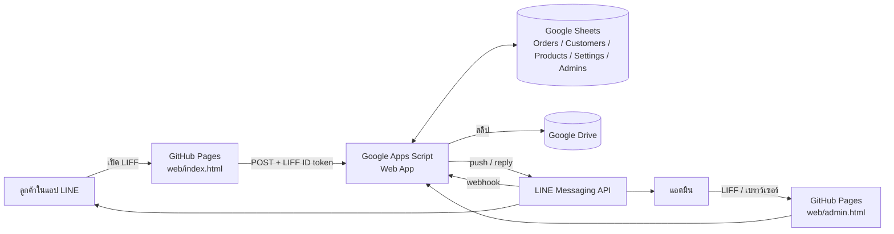
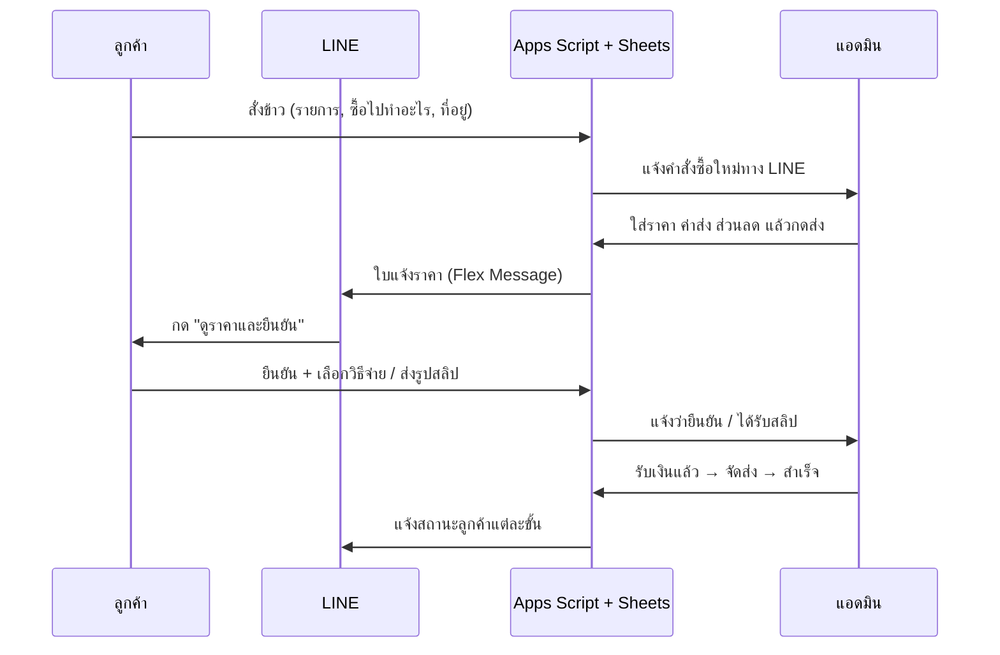

# ระบบสั่งข้าวสารผ่าน LINE OA

เว็บแอปสั่งข้าวสารที่เปิดจากแชท LINE ออกแบบให้ **ผู้สูงวัยใช้ง่าย** — ตัวอักษรใหญ่ปรับได้ 3 ระดับ ปุ่มใหญ่ ทำทีละขั้น และสั่งซ้ำได้ในปุ่มเดียว
ลูกค้าบอกว่าซื้อข้าวไปทำอะไร (กินเอง / ทำบุญ / ร้านอาหาร / ขายส่ง) ร้านคิดราคาให้เหมาะกับลูกค้าแต่ละราย แล้วส่งใบแจ้งราคาเข้า LINE ให้ลูกค้ากดยืนยันและจ่ายเงิน


## ทำอะไรได้บ้าง

**ลูกค้า (เปิดใน LINE)**
- ลงทะเบียนครั้งเดียว: ชื่อ เบอร์โทร ที่อยู่ ปุ่ม "ใช้ตำแหน่งที่อยู่ตอนนี้" และวัตถุประสงค์ที่ซื้อเป็นประจำ
- สั่งข้าว 4 ขั้น: เลือกข้าวและจำนวน → ซื้อไปทำอะไร → ส่งถึงที่หรือมารับเอง + วันที่ต้องการ → ตรวจใบสั่งข้าวแล้วกดส่ง
- ได้ใบแจ้งราคาในแชท LINE → กดยืนยัน → เลือกจ่ายด้วย QR พร้อมเพย์ (สร้างอัตโนมัติตามยอด) หรือเงินสดปลายทาง → ส่งรูปสลิป
- ติดตามสถานะเป็นขั้นตอนที่เข้าใจง่าย, สั่งเหมือนครั้งก่อน, โทรหาร้าน, ปรับขนาดตัวอักษร

**แอดมิน (หลังร้าน)**
- แจ้งเตือนคำสั่งซื้อใหม่ทาง LINE + เสียงเตือนบนหน้าเว็บ + หน้าเว็บรีเฟรชเองทุก 30 วินาที
- เห็นข้อมูลลูกค้า, ซื้อไปทำอะไร, ระยะทางจากร้าน, แผนที่, วันที่ต้องการ
- คิดราคา: ระบบเติมราคาปลีก/ราคาส่งตามวัตถุประสงค์ให้ก่อน, แนะนำค่าส่งตามระยะทาง, ใส่ส่วนลดและข้อความ → กดส่งเข้า LINE ลูกค้า
- ตรวจสลิป (ถูก/ไม่ถูก), เริ่มจัดส่ง, ส่งสำเร็จ, ยกเลิก — เลือกได้ว่าจะแจ้งลูกค้าทาง LINE หรือไม่
- สรุปยอดขายเดือนนี้, สัดส่วนลูกค้าตามวัตถุประสงค์, ค้นหา, ดาวน์โหลด CSV, เปิด Google Sheet

## โครงสร้างระบบ





สถานะคำสั่งซื้อ: `new` รอแจ้งราคา → `quoted` แจ้งราคาแล้ว → `confirmed` ลูกค้ายืนยัน → `slip` ส่งสลิปแล้ว → `paid` ชำระแล้ว → `shipping` กำลังส่ง/พร้อมให้มารับ → `done` สำเร็จ (หรือ `cancelled`)
ถ้าจ่ายเงินสด ข้ามจาก `confirmed` ไป `shipping` ได้เลย

## ไฟล์ในโปรเจกต์

```
rice-line-oa/
├── web/                    ← เว็บ (GitHub Pages)
│   ├── index.html          หน้าลูกค้า (LIFF)
│   ├── admin.html          หน้าแอดมิน
│   ├── config.js           ★ ใส่ API_URL และ LIFF_ID ที่นี่
│   ├── css/                base.css (สี/ฟอนต์), app.css, admin.css
│   ├── js/core.js          ส่วนกลาง: API, LIFF, PromptPay QR, toast/modal
│   ├── js/app.js           หน้าลูกค้า
│   ├── js/admin.js         หน้าแอดมิน
│   ├── js/demo.js          เซิร์ฟเวอร์จำลองสำหรับโหมดทดลอง
│   ├── fonts/              Sarabun (ฝังในโปรเจกต์ โหลดเร็วใน LINE)
│   └── assets/products/    รูปข้าว 10 ยี่ห้อ
├── gas/                    ← Backend (Google Apps Script)
│   ├── Code.gs             API ทั้งหมด + ตรวจ LIFF token
│   ├── Line.gs             Flex Message, push/reply, webhook
│   ├── Db.gs               อ่าน/เขียน Google Sheets
│   ├── Setup.gs            setup() สร้างชีต + ข้อมูลตัวอย่าง
│   └── appsscript.json
└── .github/workflows/
    ├── pages.yml           deploy web/ ขึ้น GitHub Pages อัตโนมัติ
    └── gas-deploy.yml      (ไม่บังคับ) deploy Apps Script ด้วย clasp
```

## ลองใช้ทันที (โหมดทดลอง)

ถ้า `config.js` ยังไม่ได้ใส่ `API_URL` / `LIFF_ID` ระบบจะเปิด **โหมดทดลอง** อัตโนมัติ — ข้อมูลเก็บในเบราว์เซอร์ ใช้ได้ครบทั้ง flow

```bash
cd web
python3 -m http.server 8080      # หรือ npx serve .
```

เปิด `http://localhost:8080` (หน้าลูกค้า) สั่งข้าว → เปิด `http://localhost:8080/admin.html` แจ้งราคา → กลับหน้าลูกค้าเพื่อยืนยันและดู QR
หลัง push ขึ้น GitHub แล้ว หน้า GitHub Pages ก็เปิดโหมดทดลองได้เหมือนกัน

## ติดตั้งใช้งานจริง

### 1. Google Sheets + Apps Script

1. สร้าง Google Sheet ใหม่ → เมนู **ส่วนขยาย → Apps Script**
2. สร้างไฟล์ `Code.gs`, `Line.gs`, `Db.gs`, `Setup.gs` แล้ววางโค้ดจากโฟลเดอร์ `gas/` (หรือใช้ clasp ดูด้านล่าง)
3. ในหน้า Project Settings ติ๊ก "Show appsscript.json" แล้ววางเนื้อหาจาก `gas/appsscript.json`
4. เลือกฟังก์ชัน `setup` แล้วกด **Run** → อนุญาตสิทธิ์ → ระบบสร้างแท็บ Orders, Customers, Products, Settings, Admins พร้อมข้าว 10 รายการ
   ดู **รหัสลงทะเบียนแอดมิน** ใน Execution log
5. **Deploy → New deployment → Web app**
   - Execute as: **Me**
   - Who has access: **Anyone**
   - คัดลอก URL ที่ลงท้ายด้วย `/exec`

### 2. LINE Developers

> Messaging API channel และ LINE Login channel **ต้องอยู่ใน Provider เดียวกัน** ไม่เช่นนั้น userId จะไม่ตรงกัน และส่งข้อความหาลูกค้าไม่ได้

**Messaging API channel** (เปิดจาก LINE Official Account Manager → ตั้งค่า → Messaging API)
- ออก **Channel access token (long-lived)**
- Webhook URL = URL `/exec` จากขั้นที่ 1 → เปิด **Use webhook**
  (ปุ่ม Verify อาจขึ้น error 302 เพราะ Apps Script redirect — ไม่เป็นไร ระบบยังรับ event ได้)
- ใน LINE OA Manager → การตอบกลับ: เปิด **Webhook** และ **แชท** (ให้แอดมินคุยกับลูกค้าได้) ปิดข้อความตอบกลับอัตโนมัติ

**LINE Login channel** → แท็บ LIFF → Add
| | หน้าลูกค้า | หน้าแอดมิน (ไม่บังคับ) |
|---|---|---|
| Size | Full | Full |
| Endpoint URL | `https://<user>.github.io/<repo>/` | `https://<user>.github.io/<repo>/admin.html` |
| Scopes | `openid`, `profile`, `chat_message.write` | `openid`, `profile` |
| Add friend option | On (Aggressive) | Off |

แล้วกด **Publish** ช่อง LINE Login (ถ้ายังเป็น Developing คนทั่วไปจะเปิด LIFF ไม่ได้)

### 3. Script Properties

Apps Script → Project Settings → Script properties

| Key | ค่า |
|---|---|
| `LINE_CHANNEL_ACCESS_TOKEN` | token จาก Messaging API |
| `LOGIN_CHANNEL_ID` | Channel ID ของ LINE Login channel |
| `LIFF_ID` | LIFF ID หน้าลูกค้า |
| `ADMIN_URL` | `https://liff.line.me/<ADMIN_LIFF_ID>` หรือ URL หน้า admin.html |
| `ADMIN_SETUP_CODE` | สร้างให้แล้วโดย `setup()` |

รันฟังก์ชัน `checkConfig` เพื่อตรวจว่าครบ

### 4. GitHub

```bash
git remote add origin https://github.com/<user>/<repo>.git
git push -u origin main
```

- แก้ `web/config.js` ใส่ `API_URL` (URL `/exec`), `LIFF_ID`, `ADMIN_LIFF_ID` แล้ว push
- GitHub → Settings → Pages → Source: **GitHub Actions** — workflow `pages.yml` จะ deploy ให้ทุกครั้งที่ push

### 5. ตั้งตัวเองเป็นแอดมิน

เปิดหน้าแอดมิน (ลิงก์ LIFF แอดมิน หรือ `.../admin.html`) → เข้าสู่ระบบ LINE → ใส่ **รหัสลงทะเบียนแอดมิน** → เสร็จ
แอดมินที่ลงทะเบียนแล้วจะได้แจ้งเตือนทาง LINE (ปิดรายคนได้ที่แท็บ Admins คอลัมน์ `notify`)

### 6. Rich menu

ใน LINE OA Manager → ริชเมนู สร้างปุ่ม "สั่งข้าวสาร" ลิงก์ไปที่ `https://liff.line.me/<LIFF_ID>` (แนะนำปุ่มใหญ่เต็มแถว และปุ่ม "โทรหาร้าน")
พิมพ์ในแชทได้ด้วย: `สั่งข้าว` เพื่อเปิดเมนู, `สถานะ` เพื่อดูคำสั่งซื้อล่าสุด

## ปรับแต่ง

- **ข้าว/ราคา** แท็บ `Products`: `price` = ราคาปลีก, `priceWholesale` = ราคาส่ง (ใช้กับลูกค้าร้านอาหาร/ขายส่ง), `active` = FALSE เพื่อซ่อน, `image` ใส่ path ใน `web/assets/products/` หรือ URL รูป
  *ราคาที่ใส่มาเป็นตัวอย่าง กรุณาแก้ให้ตรงกับร้าน*
- **ร้าน** แท็บ `Settings`: ชื่อร้าน เบอร์โทร ที่อยู่ เวลาทำการ พิกัดร้าน (`SHOP_LAT/LNG` ใช้คำนวณระยะทาง), พร้อมเพย์, ข้อมูลบัญชี, รับเงินสดปลายทาง, สูตรค่าส่งแนะนำ (`SHIP_BASE`, `SHIP_PER_KM`, `FREE_SHIP_BAGS`)
- แก้ชีตแล้วมีผลภายใน 1 นาที (หรือรัน `clearCache` เพื่อให้มีผลทันที)
- **สี/ฟอนต์** อยู่ที่ `web/css/base.css` ส่วน `:root`
- **วัตถุประสงค์** แก้ที่ `PURPOSES` ใน `web/js/core.js` และ `gas/Code.gs` ให้ตรงกัน

## โควตาข้อความ LINE

| เหตุการณ์ | วิธีส่ง | นับโควตา |
|---|---|---|
| ลูกค้าสั่ง/ยืนยัน/ส่งสลิป → การ์ดสถานะในแชท | หน้าเว็บส่งข้อความแทนลูกค้า แล้วบอท **reply** | ไม่นับ |
| ลูกค้าเพิ่มเพื่อน / พิมพ์ "สั่งข้าว" "สถานะ" | reply | ไม่นับ |
| แจ้งเตือนแอดมิน | multicast | นับตามจำนวนแอดมิน |
| ใบแจ้งราคา, แจ้งสถานะจากแอดมิน | push | นับ 1 ต่อครั้ง |

ถ้าโควตาใกล้หมด: ตั้ง `ADMIN_NOTIFY` = FALSE (ดูหน้าแอดมินแทน) และเอาติ๊ก "แจ้งลูกค้าทาง LINE" ออกในขั้นที่ไม่จำเป็น

## ความปลอดภัย

- ทุกคำขอจากหน้าเว็บส่ง **LIFF ID token** ไปให้ Apps Script ตรวจกับ LINE (`/oauth2/v2.1/verify`) — ลูกค้าเห็นได้เฉพาะคำสั่งซื้อของตัวเอง
- หน้าแอดมินใช้ได้เฉพาะ userId ที่อยู่ในแท็บ `Admins`
- ข้อมูลที่ผู้ใช้พิมพ์ถูกบันทึกเป็นข้อความธรรมดา (กันสูตรใน Sheet) และ escape ก่อนแสดงผล
- Apps Script อ่าน header `X-Line-Signature` ไม่ได้ webhook จึงทำแค่ **ตอบกลับ** (reply) ไม่แก้ข้อมูลใด ๆ
- รูปสลิปเก็บใน Google Drive ของเจ้าของสคริปต์ แบบส่วนตัว — แชร์โฟลเดอร์ให้แอดมินคนอื่นถ้าต้องการให้เปิดดูได้

## อัปเดต Apps Script จาก GitHub (ไม่บังคับ)

แก้โค้ดใน Apps Script แล้วต้อง **Deploy → Manage deployments → แก้ไข → Version: New version** (URL เดิม)
หรือให้ GitHub ทำให้อัตโนมัติด้วย `gas-deploy.yml`:

1. เปิด Apps Script API ที่ https://script.google.com/home/usersettings
2. บนเครื่องตัวเอง: `npm i -g @google/clasp@2.4.2 && clasp login` แล้วคัดลอกเนื้อหา `~/.clasprc.json`
3. GitHub → Settings → Secrets → Actions เพิ่ม `CLASPRC_JSON`, `SCRIPT_ID` (จาก Project Settings), `DEPLOYMENT_ID` (จาก Manage deployments)

## แก้ปัญหาที่พบบ่อย

| อาการ | วิธีแก้ |
|---|---|
| หน้าเว็บขึ้น "โหมดทดลอง" | ยังไม่ได้ใส่ `API_URL` / `LIFF_ID` ใน `web/config.js` |
| "การเข้าสู่ระบบหมดอายุ" ซ้ำ ๆ | `LOGIN_CHANNEL_ID` ไม่ตรงกับ channel ที่สร้าง LIFF |
| ลูกค้าไม่ได้รับใบแจ้งราคา | ลูกค้ายังไม่ได้เพิ่มเพื่อน/บล็อก OA หรือ Login channel กับ Messaging API อยู่คนละ Provider — หน้าแอดมินจะแสดงข้อความ error ของ LINE |
| แก้โค้ด Apps Script แล้วไม่เปลี่ยน | ต้อง Deploy เป็น New version |
| ไม่มีการ์ดตอบกลับในแชทหลังสั่ง | ต้องเปิด LIFF จากในแชทกับ OA และเปิด scope `chat_message.write` |
## 309920