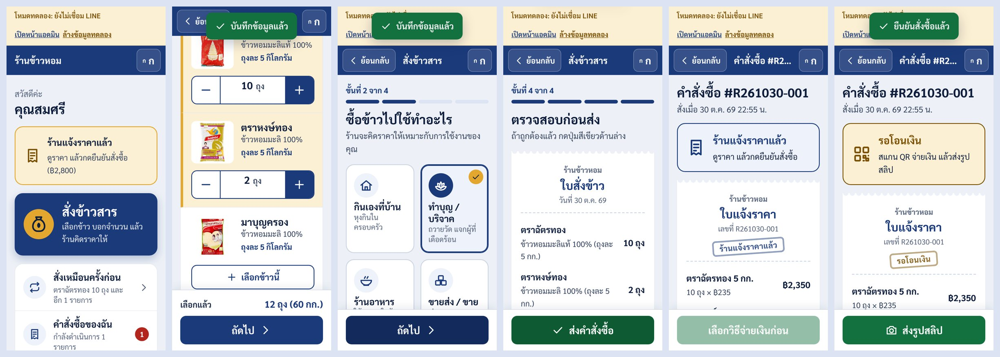
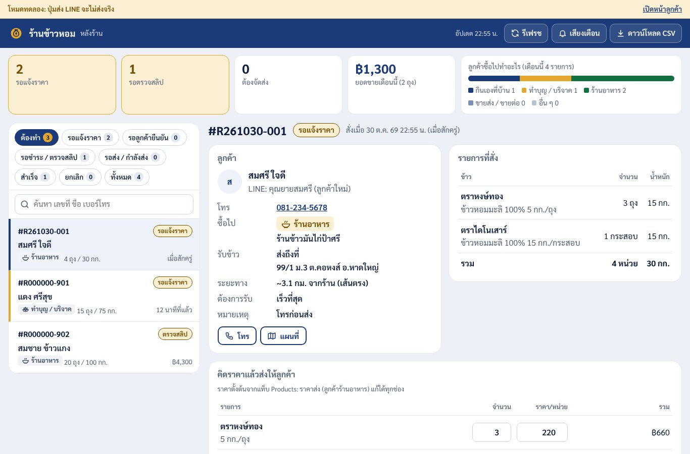
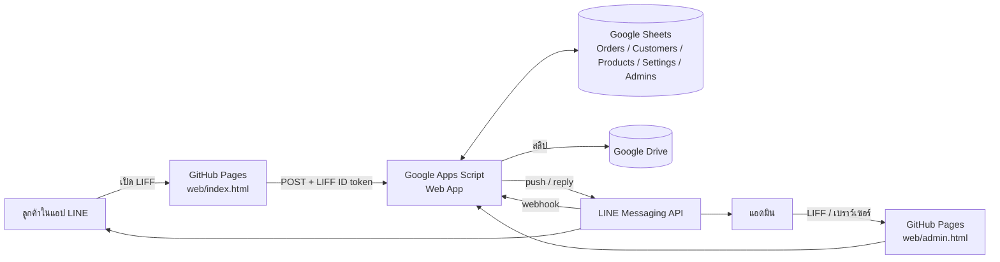
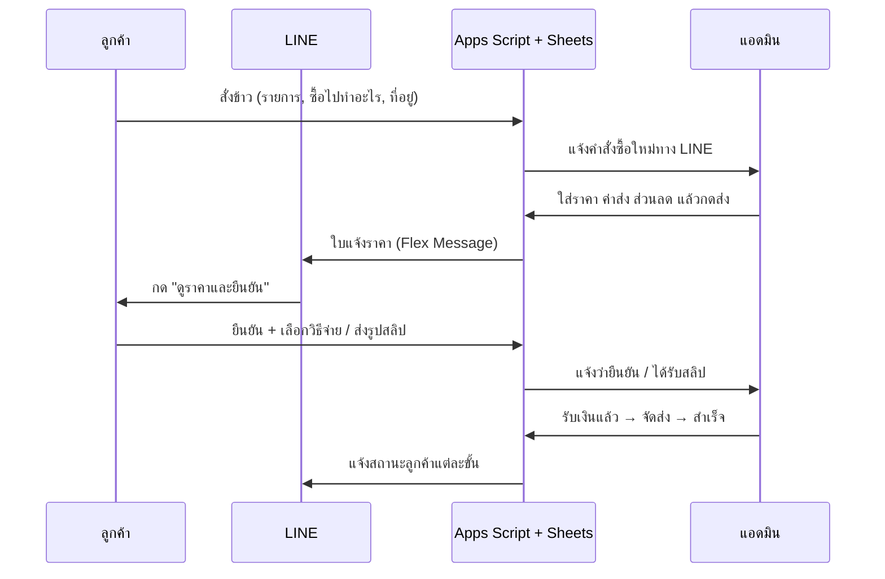
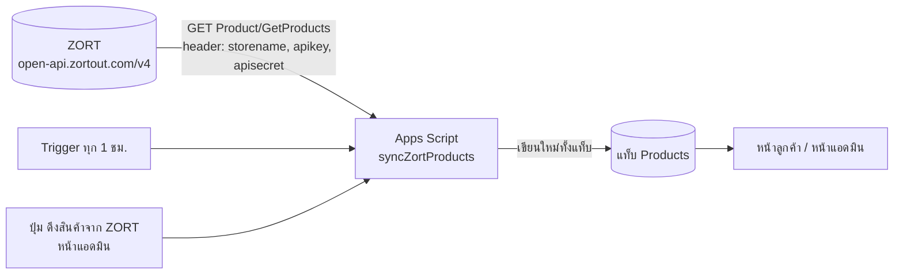

# ระบบสั่งข้าวสารผ่าน LINE OA

เว็บแอปสั่งข้าวสารที่เปิดจากแชท LINE ออกแบบให้ **ผู้สูงวัยใช้ง่าย** — ตัวอักษรใหญ่ปรับได้ 3 ระดับ ปุ่มใหญ่ ทำทีละขั้น และสั่งซ้ำได้ในปุ่มเดียว
ลูกค้าบอกว่าซื้อข้าวไปทำอะไร (กินเอง / ทำบุญ / ร้านอาหาร / ขายส่ง) ร้านคิดราคาให้เหมาะกับลูกค้าแต่ละราย แล้วส่งใบแจ้งราคาเข้า LINE ให้ลูกค้ากดยืนยันและจ่ายเงิน





## ทำอะไรได้บ้าง

**ลูกค้า (เปิดใน LINE)**
- ค้นหาข้าวด้วยชื่อหรือน้ำหนัก (เช่น "หอมมะลิ", "5 กก.", "กระสอบ") และกดกรองตาม **หมวด / หน่วย / น้ำหนัก** ได้ (ปุ่มกรองแสดงเมื่อมีตัวเลือกตั้งแต่ 2 แบบขึ้นไป)
- ลงทะเบียนครั้งเดียว: ชื่อ เบอร์โทร ที่อยู่ ปุ่ม "ใช้ตำแหน่งที่อยู่ตอนนี้" และวัตถุประสงค์ที่ซื้อเป็นประจำ
- สั่งข้าว 4 ขั้น: เลือกข้าวและจำนวน → ซื้อไปทำอะไร → ส่งถึงที่หรือมารับเอง + วันที่ต้องการ → ตรวจใบสั่งข้าวแล้วกดส่ง
- ได้ใบแจ้งราคาในแชท LINE → กดยืนยัน → เลือกจ่ายด้วย QR พร้อมเพย์ (สร้างอัตโนมัติตามยอด) หรือเงินสดปลายทาง → ส่งรูปสลิป
- ติดตามสถานะเป็นขั้นตอนที่เข้าใจง่าย, สั่งเหมือนครั้งก่อน, โทรหาร้าน, ปรับขนาดตัวอักษร

**แอดมิน (หลังร้าน)**
- แจ้งเตือนคำสั่งซื้อใหม่ทาง LINE + เสียงเตือนบนหน้าเว็บ + หน้าเว็บรีเฟรชเองทุก 30 วินาที
- เห็นข้อมูลลูกค้า, ซื้อไปทำอะไร, ระยะทางจากร้าน, แผนที่, วันที่ต้องการ
- คิดราคา: ระบบเติมราคาปลีก/ราคาส่งตามวัตถุประสงค์ให้ก่อน, แนะนำค่าส่งตามระยะทาง, ใส่ส่วนลดและข้อความ → กดส่งเข้า LINE ลูกค้า
- ตรวจสลิป (ถูก/ไม่ถูก), เริ่มจัดส่ง, ส่งสำเร็จ, ยกเลิก — เลือกได้ว่าจะแจ้งลูกค้าทาง LINE หรือไม่
- สรุปยอดขายเดือนนี้, สัดส่วนลูกค้าตามวัตถุประสงค์, ค้นหา, ดาวน์โหลด CSV, เปิด Google Sheet

## โครงสร้างระบบ





สถานะคำสั่งซื้อ: `new` รอแจ้งราคา → `quoted` แจ้งราคาแล้ว → `confirmed` ลูกค้ายืนยัน → `slip` ส่งสลิปแล้ว → `paid` ชำระแล้ว → `shipping` กำลังส่ง/พร้อมให้มารับ → `done` สำเร็จ (หรือ `cancelled`)
ถ้าจ่ายเงินสด ข้ามจาก `confirmed` ไป `shipping` ได้เลย

## ไฟล์ในโปรเจกต์

```
rice-line-oa/
├── web/                    ← เว็บ (GitHub Pages)
│   ├── index.html          หน้าลูกค้า (LIFF)
│   ├── admin.html          หน้าแอดมิน
│   ├── config.js           ★ ใส่ API_URL และ LIFF_ID ที่นี่
│   ├── css/                base.css (สี/ฟอนต์), app.css, admin.css
│   ├── js/core.js          ส่วนกลาง: API, LIFF, PromptPay QR, toast/modal
│   ├── js/app.js           หน้าลูกค้า
│   ├── js/admin.js         หน้าแอดมิน
│   ├── js/demo.js          เซิร์ฟเวอร์จำลองสำหรับโหมดทดลอง
│   ├── fonts/              Sarabun (ฝังในโปรเจกต์ โหลดเร็วใน LINE)
│   └── assets/             โลโก้ร้าน + รูปแทนเมื่อสินค้าไม่มีรูป
├── gas/                    ← Backend (Google Apps Script)
│   ├── Code.gs             API ทั้งหมด + ตรวจ LIFF token
│   ├── Line.gs             Flex Message, push/reply, webhook
│   ├── Db.gs               อ่าน/เขียน Google Sheets
│   ├── Setup.gs            setup() สร้างชีต + ข้อมูลตัวอย่าง
│   ├── Zort.gs             ดึงสินค้าข้าวจาก ZORT (ราคา/สต็อก) ลงแท็บ Products
│   └── appsscript.json
└── .github/workflows/
    ├── pages.yml           deploy web/ ขึ้น GitHub Pages อัตโนมัติ
    └── gas-deploy.yml      (ไม่บังคับ) deploy Apps Script ด้วย clasp
```

## ลองใช้ทันที (โหมดทดลอง)

ถ้า `config.js` ยังไม่ได้ใส่ `API_URL` / `LIFF_ID` ระบบจะเปิด **โหมดทดลอง** อัตโนมัติ — ข้อมูลเก็บในเบราว์เซอร์ ใช้ได้ครบทั้ง flow

```bash
cd web
python3 -m http.server 8080      # หรือ npx serve .
```

เปิด `http://localhost:8080` (หน้าลูกค้า) สั่งข้าว → เปิด `http://localhost:8080/admin.html` แจ้งราคา → กลับหน้าลูกค้าเพื่อยืนยันและดู QR
หลัง push ขึ้น GitHub แล้ว หน้า GitHub Pages ก็เปิดโหมดทดลองได้เหมือนกัน

## ติดตั้งใช้งานจริง

### 1. Google Sheets + Apps Script

1. สร้าง Google Sheet ใหม่ → เมนู **ส่วนขยาย → Apps Script**
2. สร้างไฟล์ `Code.gs`, `Line.gs`, `Db.gs`, `Setup.gs`, `Zort.gs` แล้ววางโค้ดจากโฟลเดอร์ `gas/` (หรือใช้ clasp ดูด้านล่าง)
3. ในหน้า Project Settings ติ๊ก "Show appsscript.json" แล้ววางเนื้อหาจาก `gas/appsscript.json`
4. เลือกฟังก์ชัน `setup` แล้วกด **Run** → อนุญาตสิทธิ์ → ระบบสร้างแท็บ Orders, Customers, Products, Settings, Admins (แท็บ Products ว่างไว้ ข้าวทั้งหมดดึงจาก ZORT ในขั้นที่ 7)
   ดู **รหัสลงทะเบียนแอดมิน** ใน Execution log
5. **Deploy → New deployment → Web app**
   - Execute as: **Me**
   - Who has access: **Anyone**
   - คัดลอก URL ที่ลงท้ายด้วย `/exec`

### 2. LINE Developers

> Messaging API channel และ LINE Login channel **ต้องอยู่ใน Provider เดียวกัน** ไม่เช่นนั้น userId จะไม่ตรงกัน และส่งข้อความหาลูกค้าไม่ได้

**Messaging API channel** (เปิดจาก LINE Official Account Manager → ตั้งค่า → Messaging API)
- ออก **Channel access token (long-lived)**
- Webhook URL = URL `/exec` จากขั้นที่ 1 → เปิด **Use webhook**
  (ปุ่ม Verify อาจขึ้น error 302 เพราะ Apps Script redirect — ไม่เป็นไร ระบบยังรับ event ได้)
- ใน LINE OA Manager → การตอบกลับ: เปิด **Webhook** และ **แชท** (ให้แอดมินคุยกับลูกค้าได้) ปิดข้อความตอบกลับอัตโนมัติ

**LINE Login channel** → แท็บ LIFF → Add
| | หน้าลูกค้า | หน้าแอดมิน (ไม่บังคับ) |
|---|---|---|
| Size | Full | Full |
| Endpoint URL | `https://<user>.github.io/<repo>/` | `https://<user>.github.io/<repo>/admin.html` |
| Scopes | `openid`, `profile`, `chat_message.write` | `openid`, `profile` |
| Add friend option | On (Aggressive) | Off |

แล้วกด **Publish** ช่อง LINE Login (ถ้ายังเป็น Developing คนทั่วไปจะเปิด LIFF ไม่ได้)

### 3. Script Properties

Apps Script → Project Settings → Script properties

| Key | ค่า |
|---|---|
| `LINE_CHANNEL_ACCESS_TOKEN` | token จาก Messaging API |
| `LOGIN_CHANNEL_ID` | Channel ID ของ LINE Login channel |
| `LIFF_ID` | LIFF ID หน้าลูกค้า |
| `ADMIN_URL` | `https://liff.line.me/<ADMIN_LIFF_ID>` หรือ URL หน้า admin.html |
| `ADMIN_SETUP_CODE` | สร้างให้แล้วโดย `setup()` |

รันฟังก์ชัน `checkConfig` เพื่อตรวจว่าครบ

### 4. GitHub

```bash
git remote add origin https://github.com/<user>/<repo>.git
git push -u origin main
```

- แก้ `web/config.js` ใส่ `API_URL` (URL `/exec`), `LIFF_ID`, `ADMIN_LIFF_ID` แล้ว push
- GitHub → Settings → Pages → Source: **GitHub Actions** — workflow `pages.yml` จะ deploy ให้ทุกครั้งที่ push

### 5. ตั้งตัวเองเป็นแอดมิน

เปิดหน้าแอดมิน (ลิงก์ LIFF แอดมิน หรือ `.../admin.html`) → เข้าสู่ระบบ LINE → ใส่ **รหัสลงทะเบียนแอดมิน** → เสร็จ
แอดมินที่ลงทะเบียนแล้วจะได้แจ้งเตือนทาง LINE (ปิดรายคนได้ที่แท็บ Admins คอลัมน์ `notify`)

### 6. Rich menu

ใน LINE OA Manager → ริชเมนู สร้างปุ่ม "สั่งข้าวสาร" ลิงก์ไปที่ `https://liff.line.me/<LIFF_ID>` (แนะนำปุ่มใหญ่เต็มแถว และปุ่ม "โทรหาร้าน")
พิมพ์ในแชทได้ด้วย: `สั่งข้าว` เพื่อเปิดเมนู, `สถานะ` เพื่อดูคำสั่งซื้อล่าสุด

### 7. ดึงข้อมูลข้าวจาก ZORT (จำเป็น)

ข้าวทุกรายการในระบบมาจาก [ZORT](https://www.zortout.com) **เพียงแหล่งเดียว** ทั้งชื่อ, SKU, ราคาขาย, สต็อกพร้อมขาย, รูป และสถานะเปิด/ปิดขาย ทุกครั้งที่ซิงก์ แท็บ `Products` จะถูกเขียนใหม่ทั้งแท็บ
ถ้าจะเพิ่ม ลบ หรือแก้ข้าว ให้ทำใน ZORT ถ้าแก้ในชีต ค่าจะถูกทับในการซิงก์ครั้งถัดไป (โค้ดอยู่ที่ `gas/Zort.gs`)



**7.1 ขอ API Key จาก ZORT**
1. เข้าสู่ระบบ ZORT ด้วยบัญชีเจ้าของร้าน
2. ไปที่ **Setting (ตั้งค่า) → Integration (เชื่อมต่อ) → เพิ่มการเชื่อมต่อ → ZORT Connect → เลือกประเภท ZORT API** → เลือกคลังสินค้า → กด **Generate** (ตามคู่มือ [How to Use ZORT API](https://zortout.com/en?p=47292) ชื่อเมนูภาษาไทยอาจต่างเล็กน้อย ถ้าไม่เจอให้ติดต่อ support@zortout.com) แล้วคัดลอก 3 ค่า
   - **storename** ชื่อร้านในระบบ ZORT
   - **apikey**
   - **apisecret**
3. ทั้ง 3 ค่านี้ใช้แทนรหัสผ่านร้าน ห้ามใส่ในชีต ใน `web/` หรือ push ขึ้น GitHub

**7.2 ใส่ค่าใน Apps Script**: Project Settings → Script properties

| Key | ค่า |
|---|---|
| `ZORT_STORENAME` | storename |
| `ZORT_APIKEY` | apikey |
| `ZORT_APISECRET` | apisecret |

อัปโหลดไฟล์ `gas/Zort.gs` เพิ่มเข้าโปรเจกต์ Apps Script แล้วรัน `setup()` อีกครั้ง ระบบจะเพิ่มคอลัมน์ `sku`, `zortId`, `stock`, `syncedAt` ในแท็บ Products และเพิ่มค่า `ZORT_*` ในแท็บ Settings (ข้อมูลลูกค้าและคำสั่งซื้อเดิมไม่หาย)

**7.3 ทดสอบและเลือกเฉพาะสินค้าข้าว**: รันทีละฟังก์ชันแล้วดู Execution log
1. `testZort` ถ้าเชื่อมต่อได้ จะขึ้นจำนวนสินค้าทั้งร้านและตัวอย่าง 5 รายการ
2. `zortListCategories` แสดงหมวดสินค้าพร้อม id นำ id ของหมวดข้าวไปใส่ `ZORT_CATEGORY_IDS` ในแท็บ Settings (หลายหมวดให้คั่นด้วย `,`)
   ถ้าไม่ได้แบ่งหมวดไว้ ให้ใช้ `ZORT_KEYWORD` (ค่าเริ่มต้นคือ `ข้าว`) ระบบเลือกสินค้าที่ชื่อ หมวด หรือ SKU มีคำนี้ คั่นหลายคำด้วย `,`
3. `zortPreview` แสดงรายการที่จะดึง โดยยังไม่เขียนลงชีต
4. `syncZortProducts` ดึงข้อมูลจริง: **ข้าวเดิมในชีตที่ไม่ได้มาจาก ZORT (เช่น p01–p10) จะถูกลบ** แล้วแทนด้วยรายการจาก ZORT
5. `installZortTrigger` ตั้งให้ซิงก์เองทุก 1 ชั่วโมง (`removeZortTrigger` ใช้ยกเลิก)

หลังตั้งค่าครบ หน้าแอดมินจะมีปุ่ม **"ดึงสินค้าจาก ZORT"** ให้กดซิงก์ได้ทันที

**กฎการซิงก์**

| ข้อมูล | พฤติกรรม |
|---|---|
| `id` | `z<id ใน ZORT>` เช่น `z1234` |
| `name`, `sku`, `price`, `image`, `unit`, `detail` | จาก ZORT ทุกครั้ง (`sellprice` = ราคาปลีก, `description` หรือชื่อหมวด = รายละเอียด) |
| `sizeKg` | อ่านจากชื่อสินค้า เช่น "ข้าวหอมมะลิ 5 กก." ได้ 5 แล้วตัดคำว่า "5 กก." ออกจากชื่อ (หน้าเว็บและ LINE ต่อท้ายขนาดให้เอง) ถ้าชื่อไม่มีขนาด จะใช้น้ำหนักในหน่วยกรัมใน ZORT แทน |
| `category` | ชื่อหมวดสินค้าใน ZORT ใช้เป็นปุ่มกรอง "หมวด" ในหน้าเลือกข้าว |
| `stock` | ใช้ `availablestock` (สต็อกพร้อมขาย) ถ้าตั้ง `ZORT_WAREHOUSE_CODE` จะใช้สต็อกของคลังนั้น |
| `active` | ดึงเฉพาะสินค้าที่เปิดใช้งานใน ZORT ถ้าจะปิดขายข้าวรายการไหน ให้ปิดใน ZORT |
| `priceWholesale`, `sort` | ZORT ไม่มีข้อมูลนี้ ระบบจึงเก็บค่าที่ร้านใส่ในชีตไว้ให้ (ใช้ `zortId` เดิมจับคู่) |
| ข้าวที่ไม่อยู่ใน ZORT | ถูกลบออกจากแท็บ Products (คำสั่งซื้อเก่ายังแสดงชื่อข้าวเดิมได้ตามปกติ) |
| ดึงไม่สำเร็จ / ได้ 0 รายการ | ไม่แตะชีตเลย ข้าวเดิมยังอยู่ กันรายการข้าวหายหมดเพราะเน็ตล่มหรือตั้งค่าผิด |
| สินค้าประเภทบริการ (`producttype` = 1) | ไม่ดึงมา |
| `ZORT_HIDE_OUT_OF_STOCK` = TRUE | ข้าวที่สต็อกเหลือ 0 จะไม่แสดงในหน้าลูกค้าและสั่งซื้อไม่ได้ |

**รูปสินค้า** (หาให้เองทุกครั้งที่ดึงสินค้า)

1. **โฟลเดอร์ "รูปสินค้า — ระบบสั่งข้าว" ใน Google Drive** (สร้างเองตอนซิงก์ครั้งแรก, เปิดได้จากปุ่ม "โฟลเดอร์รูปสินค้า" ในหน้าแอดมิน หรือรัน `productImageFolder`)
   ตั้งชื่อไฟล์รูปตาม **SKU** หรือ **ชื่อสินค้าใน ZORT** แล้ววางลงโฟลเดอร์ เช่น `P0002.jpg`, `ข้าวหอมมะลิ ตราฉัตรทอง 5 กก.jpg` (เฉพาะขนาดนั้น) หรือ `ข้าวหอมมะลิ ตราฉัตรทอง.jpg` (ใช้ทุกขนาด)
   ไม่สนตัวพิมพ์ ช่องว่าง และจุด — ระบบเปิดสิทธิ์ "ทุกคนที่มีลิงก์ดูได้" ให้ไฟล์รูปเอง
2. ถ้าไม่มีใน Drive → ใช้รูปของสินค้าใน ZORT (`imagepath` หรือรูปแรกใน `imageList`)
3. ไม่มีทั้งคู่ → **ค้นรูปด้วยชื่อสินค้าจาก [Open Food Facts](https://world.openfoodfacts.org)** (ฟรี ไม่ต้องสมัคร ไม่ต้องใส่ key) แล้วดาวน์โหลดเก็บในโฟลเดอร์ย่อย "รูปจากเว็บ (อัตโนมัติ)" (ชื่อไฟล์ `z<รหัส ZORT>`) และบันทึกลิงก์ในคอลัมน์ `image` ของแท็บ Products — ครั้งต่อไปใช้ไฟล์เดิม ไม่ค้นซ้ำ
   - รับเฉพาะผลในหมวดข้าว ที่ชนิดข้าวตรง (เช่น ข้าวหอมมะลิ) และยี่ห้อตรง (ถ้าชื่อสินค้ามียี่ห้อ) ไม่รับอาหารสำเร็จรูป/ขนม/ถุงเล็กกว่า 500 กรัม — ไม่ตรงพอจะไม่ใส่รูป ดีกว่าใส่รูปยี่ห้ออื่น
   - Open Food Facts มีข้าวไทยเฉพาะบางยี่ห้อ ข้าวที่ไม่มีในฐานข้อมูลจะยังไม่มีรูป ให้วางรูปเองในโฟลเดอร์หลัก
   - แท็บ Settings: `WEB_IMAGE_SEARCH` (TRUE/FALSE), `WEB_IMAGE_MAX_PER_SYNC` (ค่าเริ่มต้น 10 สินค้าต่อรอบ) — ค้นไม่เจอจะรอ 7 วันค่อยค้นใหม่
   - ค้นหลังบันทึกรายการข้าวเสร็จแล้ว ลูกค้าสั่งข้าวได้ตามปกติระหว่างค้น
   - รูปใช้สัญญา CC BY-SA ของ Open Food Facts (แหล่งที่มาบันทึกในคำอธิบายไฟล์) — ถ้ารูปไม่ถูก **ลบไฟล์ทิ้ง** (ระบบค้นใหม่) หรือ **วางรูปที่ถูกในโฟลเดอร์หลัก** (ใช้ก่อนเสมอ)
   - ทดสอบ: รัน `testWebImage` (ดูผลอย่างเดียว ไม่บันทึกไฟล์)
4. ไม่พบรูปเลย → หน้าเว็บแสดงรูปกระสอบข้าวแทน

หลังซิงก์ หน้าแอดมินบอกว่าได้รูปจาก Drive / ZORT / เว็บ / ไม่มีรูป กี่รายการ — `zortPreview` บอกชื่อไฟล์ที่ควรตั้งสำหรับสินค้าที่ยังไม่มีรูป

**บันทึกยอดขายกลับเข้า ZORT** (อัตโนมัติเมื่อปิดการขาย)

เมื่อแอดมินกดปุ่มปิดการขาย ("ส่งสำเร็จ" / "ลูกค้ามารับแล้ว" → สถานะ `done`) ระบบส่งคำสั่งซื้อเข้า ZORT ด้วย `POST Order/AddOrder` เป็นสถานะ **Success** พร้อมการชำระเงิน
- เลขที่คำสั่งซื้อใน ZORT = เลขของระบบ (เช่น `R261107-001`) และส่งเป็น `uniquenumber` กันบันทึกซ้ำ
- รายการสินค้าใช้ **SKU** ของข้าวที่ดึงมาจาก ZORT, ราคาต่อหน่วยตามใบแจ้งราคา, ค่าส่ง, ส่วนลด, ชื่อ/เบอร์/ที่อยู่ลูกค้า, วิธีชำระ (โอน/เงินสด) และวันที่ชำระ
- ผลบันทึกไว้ในแท็บ Orders คอลัมน์ `zortOrderId`, `zortSyncedAt`, `zortError` — หน้าแอดมินแสดง "บันทึกยอดขายใน ZORT แล้ว" หรือสาเหตุที่ไม่สำเร็จพร้อมปุ่ม **ส่งเข้า ZORT อีกครั้ง** (การปิดการขายสำเร็จเสมอ ไม่ถูกขวาง)
- ตั้งค่าในแท็บ Settings: `ZORT_PUSH_ORDERS`, `ZORT_SALES_CHANNEL`, `ZORT_ORDER_VATTYPE` (1 = ไม่มี VAT), `ZORT_PAYMENT_TRANSFER` / `ZORT_PAYMENT_CASH` (ให้ตรงกับชื่อวิธีชำระเงินที่ตั้งไว้ใน ZORT)
- รัน `previewZortOrder` ดูข้อมูลที่จะส่ง (ไม่ส่งจริง), `pushPendingOrdersToZort` ส่งย้อนหลังรายการที่ปิดแล้วแต่ยังไม่ได้บันทึก
- **ยกเลิกหลังบันทึกเข้า ZORT แล้ว** (ปุ่ม "ยกเลิกการขายนี้" ในคำสั่งซื้อที่ปิดแล้ว หรือยกเลิกรายการที่บันทึกไว้): ระบบยกเลิกใน ZORT ให้อัตโนมัติไม่ได้ จึง
  - ติดสถานะ `zortVoidStatus = pending` และแจ้งเตือนแอดมินทาง LINE
  - หน้าแอดมิน: กล่องสรุปสีแดง **"รอยกเลิกใน ZORT"**, แท็บกรองชื่อเดียวกัน (รวมอยู่ใน "ต้องทำ"), ป้ายในรายการ และกล่องแจ้งขั้นตอนบนสุดของคำสั่งซื้อ
  - ไปยกเลิก (Void) ในหน้า ZORT แล้วกด **"ยกเลิกใน ZORT แล้ว"** → บันทึกว่าใครปิดงานเมื่อไร (`zortVoidAt`, `zortVoidBy`) และลงประวัติ

**API ของ ZORT ที่ใช้** ([เอกสาร](https://developers.zortout.com/api-reference/product))

```http
GET https://open-api.zortout.com/v4/Product/GetProducts?keyword=ข้าว&activestatus=1&page=1&limit=500
storename: <storename>
apikey: <apikey>
apisecret: <apisecret>
```
- พารามิเตอร์ที่ใช้: `categoryid`, `keyword`, `activestatus=1`, `warehousecode`, `page`, `limit` (สูงสุด 500 ต่อหน้า ระบบวนดึงทุกหน้าให้เอง)
- ฟิลด์ที่ใช้จากผลลัพธ์: `list[].id, sku, name, description, sellprice, availablestock, unittext, imagepath, weight, category, producttype, active` และ `count`
- `GET Product/GetCategorys` (ZORT สะกดแบบนี้) ใช้ดูรายชื่อหมวด
- ทดสอบด้วย curl ได้:
  ```bash
  curl -H "storename: XXX" -H "apikey: XXX" -H "apisecret: XXX" \
    "https://open-api.zortout.com/v4/Product/GetProducts?page=1&limit=5"
  ```

**แก้ปัญหา ZORT**

| อาการ | วิธีแก้ |
|---|---|
| `ZORT ปฏิเสธการเชื่อมต่อ (HTTP 401/403)` | storename / apikey / apisecret ผิด หรือมีช่องว่างติดมาตอนคัดลอก |
| `ZORT ตอบกลับ error 100` | ส่งพารามิเตอร์ผิด เช่น `ZORT_CATEGORY_IDS` ไม่ใช่ตัวเลข ให้รัน `zortListCategories` ดูใหม่ |
| ดึงได้ 0 รายการ | หมวดหรือคำค้นไม่ตรง ให้ลองรัน `zortPreview` หลังล้างค่า `ZORT_CATEGORY_IDS` |
| แก้ราคา/ชื่อในชีตแล้วกลับเป็นค่าเดิม | ระบบใช้ข้อมูลจาก ZORT อย่างเดียว ให้แก้ใน ZORT (ยกเว้น `priceWholesale` และ `sort` ที่แก้ในชีตได้) |
| ขนาดถุงขึ้น 0 กก. | ใส่ขนาดในชื่อสินค้าใน ZORT เช่น "5 กก." หรือใส่น้ำหนัก (กรัม) ในหน้าสินค้า ZORT |
| ไม่เห็นปุ่ม "ดึงสินค้าจาก ZORT" | ยังตั้ง Script properties ไม่ครบ 3 ค่า หรือยังไม่ได้ Deploy เป็น New version |

## ปรับแต่ง

- **ข้าว/ราคา** แก้ที่ ZORT แล้วกด "ดึงสินค้าจาก ZORT" ในหน้าแอดมิน (หรือรอซิงก์อัตโนมัติ) ในชีตแก้ได้เฉพาะ `priceWholesale` = ราคาส่ง (ใช้กับลูกค้าร้านอาหาร/ขายส่ง ถ้าว่างจะใช้ราคาปลีก) และ `sort` = ลำดับที่แสดง
- **ร้าน** แท็บ `Settings`: ชื่อร้าน เบอร์โทร ที่อยู่ เวลาทำการ พิกัดร้าน (`SHOP_LAT/LNG` ใช้คำนวณระยะทาง), พร้อมเพย์, ข้อมูลบัญชี, รับเงินสดปลายทาง, สูตรค่าส่งแนะนำ (`SHIP_BASE`, `SHIP_PER_KM`, `FREE_SHIP_BAGS`)
- แก้ชีตแล้วมีผลภายใน 1 นาที (หรือรัน `clearCache` เพื่อให้มีผลทันที)
- **สี/ฟอนต์** อยู่ที่ `web/css/base.css` ส่วน `:root`
- **วัตถุประสงค์** แก้ที่ `PURPOSES` ใน `web/js/core.js` และ `gas/Code.gs` ให้ตรงกัน

## โควตาข้อความ LINE

| เหตุการณ์ | วิธีส่ง | นับโควตา |
|---|---|---|
| ลูกค้าสั่ง/ยืนยัน/ส่งสลิป → การ์ดสถานะในแชท | หน้าเว็บส่งข้อความแทนลูกค้า แล้วบอท **reply** | ไม่นับ |
| ลูกค้าเพิ่มเพื่อน / พิมพ์ "สั่งข้าว" "สถานะ" | reply | ไม่นับ |
| แจ้งเตือนแอดมิน | multicast | นับตามจำนวนแอดมิน |
| ใบแจ้งราคา, แจ้งสถานะจากแอดมิน | push | นับ 1 ต่อครั้ง |

ถ้าโควตาใกล้หมด: ตั้ง `ADMIN_NOTIFY` = FALSE (ดูหน้าแอดมินแทน) และเอาติ๊ก "แจ้งลูกค้าทาง LINE" ออกในขั้นที่ไม่จำเป็น

## ความปลอดภัย

- ทุกคำขอจากหน้าเว็บส่ง **LIFF ID token** ไปให้ Apps Script ตรวจกับ LINE (`/oauth2/v2.1/verify`) — ลูกค้าเห็นได้เฉพาะคำสั่งซื้อของตัวเอง
- หน้าแอดมินใช้ได้เฉพาะ userId ที่อยู่ในแท็บ `Admins`
- ข้อมูลที่ผู้ใช้พิมพ์ถูกบันทึกเป็นข้อความธรรมดา (กันสูตรใน Sheet) และ escape ก่อนแสดงผล
- Apps Script อ่าน header `X-Line-Signature` ไม่ได้ webhook จึงทำแค่ **ตอบกลับ** (reply) ไม่แก้ข้อมูลใด ๆ
- รูปสลิปเก็บใน Google Drive ของเจ้าของสคริปต์ แบบส่วนตัว — แชร์โฟลเดอร์ให้แอดมินคนอื่นถ้าต้องการให้เปิดดูได้

## อัปเดต Apps Script อัตโนมัติจาก GitHub

push โค้ดใน `gas/` ขึ้น `main` แล้ว workflow `gas-deploy.yml` จะ `clasp push` และอัปเดต Web App เดิมเป็นเวอร์ชันใหม่ให้เอง (URL `/exec` เดิม หน้าเว็บไม่ต้องแก้)
ส่วน `web/` deploy ขึ้น GitHub Pages ด้วย `pages.yml` อยู่แล้ว — push ครั้งเดียวได้ทั้งสองฝั่ง

ตั้งค่าครั้งเดียว:
1. เปิด **Google Apps Script API** ที่ https://script.google.com/home/usersettings (ด้วยบัญชี Google ที่เป็นเจ้าของ Sheet)
2. บนเครื่องตัวเอง: `npm i -g @google/clasp@3.3.0` แล้ว `clasp login` ด้วยบัญชีเดียวกัน → คัดลอกเนื้อหาไฟล์ `~/.clasprc.json` (Windows: `C:\Users\<ชื่อ>\.clasprc.json`)
3. หาค่า 2 ค่าจาก Apps Script ที่ผูกกับ Sheet (Sheet → ส่วนขยาย → Apps Script)
   - `SCRIPT_ID`: ⚙ Project Settings → **Script ID**
   - `DEPLOYMENT_ID`: Deploy → Manage deployments → **Deployment ID** ของ Web App (คือส่วน `AKfycb…` ใน `API_URL` ของ `web/config.js`)
4. GitHub repo → Settings → Secrets and variables → Actions → **New repository secret** เพิ่ม `CLASPRC_JSON`, `SCRIPT_ID`, `DEPLOYMENT_ID`
5. ทดสอบ: GitHub → Actions → **Deploy Apps Script (clasp)** → Run workflow

> `CLASPRC_JSON` คือสิทธิ์เข้าถึง Google Drive ของบัญชีนั้น — เก็บใน GitHub Secrets เท่านั้น ห้าม commit
> ถ้ายังไม่ตั้ง secrets workflow จะข้ามขั้นตอนนี้เฉย ๆ (ไม่ error) — ต้องวางโค้ดใน Apps Script แล้ว Deploy → New version เอง

## แก้ปัญหาที่พบบ่อย

| อาการ | วิธีแก้ |
|---|---|
| หน้าเว็บขึ้น "โหมดทดลอง" | ยังไม่ได้ใส่ `API_URL` / `LIFF_ID` ใน `web/config.js` |
| "การเข้าสู่ระบบหมดอายุ" ซ้ำ ๆ | `LOGIN_CHANNEL_ID` ไม่ตรงกับ channel ที่สร้าง LIFF |
| ลูกค้าไม่ได้รับใบแจ้งราคา | ลูกค้ายังไม่ได้เพิ่มเพื่อน/บล็อก OA หรือ Login channel กับ Messaging API อยู่คนละ Provider — หน้าแอดมินจะแสดงข้อความ error ของ LINE |
| แก้โค้ด Apps Script แล้วไม่เปลี่ยน | ต้อง Deploy เป็น New version |
| ไม่มีการ์ดตอบกลับในแชทหลังสั่ง | ต้องเปิด LIFF จากในแชทกับ OA และเปิด scope `chat_message.write` |
## 309920